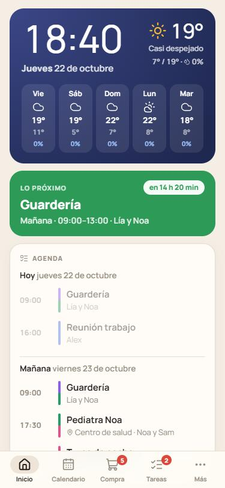

# Casa 🏠 · family hub PWA

A shared calendar and household organizer for the whole family. It's a **Progressive Web App**: it installs from the browser on Android and iPhone, with no app stores and no paid Apple Developer account. Changes show up instantly on everyone's phone.

<p align="center">
  
  &nbsp;
  
</p>

<sub>Screenshots from demo mode, with sample data. The app's interface is in Spanish: it was built for a family in Spain.</sub>

**Stack:** React + Vite (PWA with a service worker) · Firebase Auth, Firestore, Hosting and Cloud Functions · Web Push (VAPID) · [Open-Meteo](https://open-meteo.com) for weather and [REE](https://www.ree.es/es/apidatos) for electricity prices.

## Features

- **Home dashboard**: clock and weather, "up next" with a countdown, today and tomorrow agenda, today's menu, the week at a glance, plus cards for shopping, chores, electricity, key dates, expenses and notes. **Each person chooses which cards they see and in what order.** On a tablet or desktop it becomes a wall dashboard.
- **Calendar**: week and month views, one color per family member (kids too), recurring and multi-day events, and reminders.
- **Shopping list**: shared in real time, with suggestions based on what you buy most and comma-separated quick add.
- **Chores**: household tasks with an assignee; recurring ones come back automatically when checked off.
- **Meal plan**: lunch and dinner for each day, also shown in the calendar.
- **Key dates**: birthdays (with age), car inspection, insurance renewals and bills, with a reminder days in advance.
- **Expenses**: who paid what, who owes whom, and a monthly summary by category.
- **Notes**: a shared board (guest Wi-Fi, useful phone numbers…).
- **Weather** and **electricity price**: hourly Spanish regulated tariff (PVPC) and the cheapest hours to run the washing machine.
- **Push notifications**: what the other person adds arrives instantly ("Sam added to the shopping list: milk, bread and eggs"), plus event reminders, a morning summary and upcoming key dates.

---

## Try it now (demo mode)

```bash
npm install
```

```bash
npm run dev
```

Open http://localhost:5173 and tap **Probar en modo demo** (try demo mode). Sample data is stored only in that browser. Demo mode is available while Firebase is not configured (no `.env.local`).

To try it on a phone on the same Wi-Fi, open the `Network` address printed by Vite. Under WSL2 that address isn't reachable from other devices by default; run it from Windows or deploy it instead.

---

## Setup

### 1. Create the Firebase project

1. Go to <https://console.firebase.google.com> → **Create project**. Google Analytics isn't needed.
2. **Authentication** → *Get started* → *Sign-in method*: enable **Email/Password** and **Google**.
3. **Firestore Database** → *Create database* → **Standard** edition, `(default)` ID → location **`europe-southwest1` (Madrid)** → **production mode**.
   > If you pick another location, update `FIRESTORE_REGION` in [`functions/src/index.ts`](functions/src/index.ts): the instant-notification function must run in the same region as the database.
4. **Project settings** (gear icon) → *Your apps* → **`</>`** (web) → register the app. Copy the `firebaseConfig` values.
5. In the project folder, copy `.env.example` to `.env.local` and fill in those values:

   ```
   VITE_FIREBASE_API_KEY=AIza...
   VITE_FIREBASE_AUTH_DOMAIN=your-project.web.app
   VITE_FIREBASE_PROJECT_ID=your-project
   ...
   ```

   > Set `AUTH_DOMAIN` to `YOUR-PROJECT.web.app`, not the `firebaseapp.com` domain Firebase suggests. That keeps Google sign-in working inside the app installed on an iPhone. See step 3.

### 2. Deploy it (Firebase Hosting)

```bash
npm install -g firebase-tools
```

```bash
firebase login --no-localhost
```

(`--no-localhost` gives you a code to paste into the terminal; from WSL the regular browser login sometimes never returns to the terminal)

```bash
firebase use --add
```

(pick your project and give it the alias `default`)

```bash
npm run deploy:web
```

That builds the app and deploys the website and the Firestore security rules (`firestore.rules`). The app is then live at **https://YOUR-PROJECT.web.app**. Notifications come later (see below).

### 3. Google sign-in on iPhone (recommended)

Skip this if everyone signs in with email and password.

In <https://console.cloud.google.com> (same project) → *APIs & Services* → *Credentials* → *Web client (auto created by Google Service)* → under **Authorized redirect URIs**, keep the existing URI and add:

```
https://YOUR-PROJECT.web.app/__/auth/handler
```

### 4. Install it on the phones

- **Android (Chrome)**: open the site → ⋮ menu → **Install app**.
- **iPhone (Safari)**: open the site → **Share** → **Add to Home Screen**. Always open it from that icon: notifications only work there.

### 5. Create your household and invite your partner

1. Sign in and set up the household: your name, your partner's, the kids' and your city.
2. On the **home screen** (or in **Ajustes → Invitar**, Settings → Invite), tap **Compartir** (share) and send the link.
3. Your partner opens the link, creates an account, taps **Unirme** (join) and picks their name.

> On iPhone the installed app doesn't share storage with Safari: open the invite link in Safari, join there, then add it to the Home Screen and sign in again.
>
> The invite link contains the household's secret ID. Only share it with people who should join.

---

## Push notifications (Cloud Functions)

Two functions in [`functions/`](functions/), deployed to the same Firebase project, send them:

| Function | When | What |
|---|---|---|
| `onActivityCreated` | Instantly, when someone adds something | "Sam added to the shopping list: milk, bread and eggs". Bursts are grouped into one notification, sent only to the other people's phones |
| `notificationsTick` | Every 5 minutes | Event reminders, the morning summary (8:00 by default) and key dates |

### a) Switch to the Blaze plan and set a budget alert

Cloud Functions need the **Blaze** (pay-as-you-go) plan. A family's usage fits in the free tier and the expected bill is **€0**, but set an alert anyway:

1. Firebase console → bottom left, **Spark → Upgrade** → **Blaze**, and link a payment method.
2. When asked for a **budget**, enter **€1** to get an email if anything spikes.

### b) VAPID keys

```bash
npm --prefix functions install
```

```bash
npm --prefix functions run vapid
```

- The **public** key goes in `.env.local` as `VITE_VAPID_PUBLIC_KEY` (the app uses it). The first deployment will also ask for it.
- The **private** key is stored as a secret in Google Cloud (Secret Manager) with this command, which asks you to paste it. Don't save it in any file in the repo:

```bash
firebase functions:secrets:set VAPID_PRIVATE_KEY
```

### c) Deploy everything

```bash
npm run deploy
```

It deploys the website and rules first and then the functions, so a function error never blocks a website release. The first time it asks for:

- `VAPID_PUBLIC_KEY`: the public key from step b.
- `VAPID_SUBJECT`: a contact for the push services, such as `mailto:you@example.com` or your app's `https://` URL.

Both values are saved in `functions/.env.YOUR-PROJECT`, which isn't committed. If it asks how many days to keep function container images, answer **1** to avoid storage charges.

> The first deployment of the Firestore-triggered function often fails with an *Eventarc* permission error: Google needs a few minutes to provision permissions. Wait 5 minutes and run `npm run deploy` again.
>
> `npm run deploy` gives the CLI 120 s (`FUNCTIONS_DISCOVERY_TIMEOUT`) to analyze the functions. The default 10 s isn't enough from WSL with the project under `/mnt/…`, because reading `node_modules` from the Windows drive is slow (error *User code failed to load … Timeout after 10000*).

### d) Enable them on each phone

In the app: **Ajustes → Notificaciones en este móvil** (Settings → notifications on this phone). On iPhone the app must be installed on the Home Screen first, with iOS 16.4 or later.

---

## Costs

| Service | Plan | For a family |
|---|---|---|
| Firebase Auth, Firestore and Hosting | Free (also within Blaze) | Far below the limits (50,000 Firestore reads per day; the 5-minute task uses about 10,000) |
| Cloud Functions and Cloud Scheduler | Blaze | Within the free tier: 2 million invocations per month and 3 free scheduled jobs |
| Secret Manager | Blaze | 1 secret, within the free tier |
| Open-Meteo and REE | Public APIs | No key, no cost |

---

## Security and privacy

- **No credentials in the repository**:
  - The Firebase config lives in `.env.local`.
  - The VAPID private key lives in Secret Manager.
  - The functions use the project's own identity; no service account keys are downloaded.
  - `.gitignore` blocks `.env*`, `*firebase-adminsdk*.json`, `*.pem` and `*.key`.
- The Firebase web config (`VITE_FIREBASE_*`) isn't secret: it ends up in the JavaScript every browser downloads. What protects the data are the [Firestore rules](firestore.rules): only members of a household can read or change it.
- Function logs only contain IDs and counts, never the text of your events or notes.

---

## Development

```
src/
  shared/      Types, dates and recurrence (dependency-free; shared with the functions)
  lib/         Firebase, demo mode, hooks, weather, electricity, push, router, dashboard settings
  components/  Reusable components (sheets, chips, event editor, dashboard editor…)
  pages/       One screen per section
  sw.ts        Service worker (offline support and notifications)
functions/
  src/logic.ts   What to notify and when (pure logic)
  src/run.ts     Firestore reads, Web Push delivery and state
  src/index.ts   The two Cloud Functions
firestore.rules  Security rules: only household members see their data
```

- `npm run dev`: local dev server.
- `npm run build`: type-check and production build.
- `npm run deploy:web`: deploy the website and rules.
- `npm run deploy`: deploy everything, functions included (needs Blaze).
- `npm --prefix functions test`: notification tests (logic, daylight-saving edge cases and an in-memory Firestore).
- `npm run icons`: regenerate the icons (PNG and `favicon.ico`) from `public/favicon.svg` and `assets/icon-full.svg`.

> **WSL or Windows, not both.** `node_modules` contains native binaries for the system that ran `npm install` (Rolldown, TypeScript, esbuild). This project is installed from **WSL**. To use it from PowerShell, delete `node_modules` and `functions/node_modules` and reinstall there. With the project under `/mnt/d/...`, Vite polls for file changes so edits made from Windows are picked up too (already set in `vite.config.ts`).

## Ideas for later

- Wall display: a cheap tablet or a "hacked" digital photo frame (like Wes Bos's) running the app. The wide layout is already designed for it.
- Export the calendar as iCal to see it in the phone's native calendar.
- Work shifts with repeating patterns that fill themselves in.
