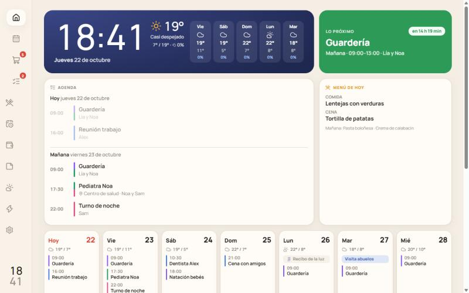

# Casa 🏠 · calendario familiar compartido

Calendario compartido y cosas de casa para la familia. Es una **PWA**: se instala desde el navegador en Android y en iPhone, sin tiendas de apps y sin pagar la cuenta de Apple Developer. Los cambios llegan al momento al móvil del resto de la familia.

<p align="center">
  
  &nbsp;
  
</p>

<sub>Capturas del modo demo, con datos ficticios.</sub>

**Tecnología:** React + Vite (PWA con service worker) · Firebase Auth, Firestore, Hosting y Cloud Functions · Web Push (VAPID) · [Open-Meteo](https://open-meteo.com) y [REE](https://www.ree.es/es/apidatos) para el tiempo y la luz.

## Qué tiene

- **Inicio**: cuadro de mando con reloj, el tiempo, «lo próximo» con cuenta atrás, agenda de hoy y mañana, menú de hoy, la semana de un vistazo y tarjetas de compra, tareas, luz, fechas, gastos y notas. **Cada persona elige qué tarjetas ve y en qué orden** (Personalizar inicio). En una tablet u ordenador se ve como un panel de pared.
- **Calendario**: vista de semana y de mes, un color por persona (también para las peques), eventos que se repiten, eventos de varios días y avisos.
- **Compra**: lista compartida en tiempo real, sugerencias de lo que más compráis y varias cosas a la vez separadas por comas.
- **Tareas**: tareas de casa con responsable; las que se repiten vuelven solas al marcarlas.
- **Menú**: comida y cena de cada día; aparecen también en el calendario.
- **Fechas**: cumpleaños (con la edad), ITV, seguros y recibos, con aviso unos días antes.
- **Gastos**: quién ha pagado qué, quién debe a quién y resumen del mes por categorías.
- **Notas**: tablón compartido (wifi de invitados, teléfonos…).
- **Tiempo** ([Open-Meteo](https://open-meteo.com)) y **luz**: precio PVPC por horas ([REE](https://www.ree.es/es/apidatos)) y las horas más baratas para la lavadora.
- **Notificaciones push**: lo que añade el otro llega al momento («Sam ha añadido a la compra: leche, pan y huevos»), además de recordatorios de eventos, resumen por la mañana y vencimientos.

---

## Probarla ya (modo demo)

```bash
npm install
```

```bash
npm run dev
```

Abre http://localhost:5173 y pulsa **Probar en modo demo**. Los datos de ejemplo se guardan solo en ese navegador. Desde el móvil, en la misma wifi, abre la dirección `Network` que muestra la consola.

---

## Puesta en marcha

### 1. Crear el proyecto de Firebase

1. Entra en <https://console.firebase.google.com> → **Crear proyecto** (por ejemplo `casa-familia`). Google Analytics no hace falta.
2. **Authentication** → *Comenzar* → *Método de inicio de sesión*: activa **Correo electrónico/contraseña** y **Google**.
3. **Firestore Database** → *Crear base de datos* → ubicación **`europe-southwest1` (Madrid)** → modo **producción**.
   > Si eliges otra ubicación, cambia `FIRESTORE_REGION` en [`functions/src/index.ts`](functions/src/index.ts): la función que avisa al momento tiene que estar en la misma región que la base de datos.
4. **Configuración del proyecto** (rueda dentada) → *Tus apps* → icono **`</>`** (web) → registra la app «Casa». Copia los valores de `firebaseConfig`.
5. En la carpeta del proyecto, copia `.env.example` como `.env.local` y pega esos valores:

   ```
   VITE_FIREBASE_API_KEY=AIza...
   VITE_FIREBASE_AUTH_DOMAIN=casa-familia.web.app
   VITE_FIREBASE_PROJECT_ID=casa-familia
   ...
   ```

   > En `AUTH_DOMAIN` pon `TU-PROYECTO.web.app` y no el `firebaseapp.com` que te propone Firebase. Así el login con Google funciona dentro de la app instalada en el iPhone. Mira el paso 3.

### 2. Publicarla (Firebase Hosting)

```bash
npm install -g firebase-tools
```

```bash
firebase login --no-localhost
```

(`--no-localhost` te da un código para pegar en la terminal; desde WSL el inicio de sesión normal a veces no vuelve a la terminal)

```bash
firebase use --add
```

(elige tu proyecto y ponle el alias `default`)

```bash
npm run deploy:web
```

El último comando compila la app y sube la web y las reglas de seguridad de Firestore (`firestore.rules`). La app queda en **https://TU-PROYECTO.web.app**. Las notificaciones se activan después (más abajo).

### 3. Login con Google en el iPhone (recomendado)

Si solo vais a entrar con email y contraseña, puedes saltarte este paso.

En <https://console.cloud.google.com> (mismo proyecto) → *APIs y servicios* → *Credenciales* → *Web client (auto created by Google Service)* → en **URIs de redireccionamiento autorizados** añade:

```
https://TU-PROYECTO.web.app/__/auth/handler
```

### 4. Instalarla en los móviles

- **Android (Chrome)**: abre la web → menú ⋮ → **Instalar aplicación**.
- **iPhone (Safari)**: abre la web → botón **Compartir** → **Añadir a pantalla de inicio**. Ábrela siempre desde ese icono: las notificaciones solo funcionan así.

### 5. Crear la casa e invitar a tu pareja

1. Entra con tu cuenta y rellena la casa: tu nombre, el de tu pareja, las peques y vuestra ciudad.
2. En **Inicio** (o en **Ajustes → Invitar**) pulsa **Compartir** y envía el enlace por WhatsApp.
3. Tu pareja abre el enlace, crea su cuenta, pulsa **Unirme** y elige quién es.

> El enlace de invitación contiene el identificador secreto de la casa. Compártelo solo con quien quieras que entre.

---

## Notificaciones push (Cloud Functions)

Las envían dos funciones de [`functions/`](functions/), que se despliegan en el mismo proyecto de Firebase:

| Función | Cuándo | Qué avisa |
|---|---|---|
| `onActivityCreated` | Al momento, cuando alguien añade algo | «Sam ha añadido a la compra: leche, pan y huevos». Lo que se añade seguido llega en un solo aviso, y solo al móvil del otro |
| `notificationsTick` | Cada 5 minutos | Recordatorios de eventos, resumen de la mañana (8:00 por defecto) y fechas clave |

### a) Activar el plan Blaze y poner un tope

Las Cloud Functions necesitan el plan **Blaze** (pago por uso). Para una familia el consumo cabe en la capa gratuita y la factura esperada es **0 €**, pero conviene poner una alerta:

1. Consola de Firebase → abajo a la izquierda, **Spark → Actualizar** → **Blaze** y vincula una forma de pago (sirve la misma cuenta de Google).
2. Al activarlo, Firebase propone crear un **presupuesto**: pon **1 €** para recibir un correo si algo se dispara.

### b) Claves VAPID

```bash
npm --prefix functions install
```

```bash
npm --prefix functions run vapid
```

- La clave **pública** va en `.env.local` como `VITE_VAPID_PUBLIC_KEY` (la usa la app) y te la pedirá también el primer despliegue.
- La **privada** se guarda como secreto en Google Cloud (Secret Manager) con el comando siguiente, que te pedirá pegarla. No la guardes en ningún archivo:

```bash
firebase functions:secrets:set VAPID_PRIVATE_KEY
```

### c) Desplegar todo

```bash
npm run deploy
```

La primera vez te preguntará:

- `VAPID_PUBLIC_KEY`: la clave pública del paso b.
- `VAPID_SUBJECT`: tu contacto, por ejemplo `mailto:tu-correo@ejemplo.com`.

Esos dos valores se guardan en `functions/.env.TU-PROYECTO`, que no se sube al repositorio. Si te pregunta cuántos días guardar las imágenes de las funciones, responde **1** para no ocupar almacenamiento.

> Es normal que el primer despliegue de la función que reacciona a Firestore falle con un error de permisos de *Eventarc*: Google tarda unos minutos en preparar sus permisos. Espera 5 minutos y repite `npm run deploy`.
>
> `npm run deploy` ya amplía a 120 s el tiempo que la CLI tiene para analizar las funciones (`FUNCTIONS_DISCOVERY_TIMEOUT`). Los 10 s por defecto no bastan desde WSL con el proyecto en `/mnt/…`, porque leer `node_modules` en el disco de Windows es lento (error *User code failed to load … Timeout after 10000*).

### d) Activarlas en cada móvil

En la app: **Ajustes → Notificaciones en este móvil**. En el iPhone, primero tiene que estar instalada en la pantalla de inicio.

---

## Costes

| Servicio | Plan | Para una familia |
|---|---|---|
| Firebase Auth, Firestore y Hosting | Gratis (también dentro de Blaze) | Muy por debajo de los límites (50.000 lecturas de Firestore al día; la tarea cada 5 minutos usa unas 10.000) |
| Cloud Functions y Cloud Scheduler | Blaze | Dentro de la capa gratuita: 2 millones de invocaciones al mes y 3 tareas programadas gratis |
| Secret Manager | Blaze | 1 secreto, dentro de lo gratuito |
| Open-Meteo y REE | APIs públicas | Sin clave y sin coste |

---

## Seguridad y privacidad

- En el repositorio **no hay credenciales**:
  - La configuración de Firebase va en `.env.local`.
  - La clave privada VAPID está en Secret Manager.
  - Las funciones usan la identidad propia del proyecto, sin descargar claves de cuenta de servicio.
  - El `.gitignore` bloquea `.env*`, `*firebase-adminsdk*.json`, `*.pem` y `*.key`.
- La configuración web de Firebase (`VITE_FIREBASE_*`) no es secreta, porque acaba en el JavaScript que descarga cualquier navegador. Lo que protege los datos son las [reglas de Firestore](firestore.rules): solo los miembros de una casa pueden leerla o modificarla.
- Los registros de las funciones solo guardan identificadores y recuentos, nunca el texto de vuestros eventos o notas.

---

## Desarrollo

```
src/
  shared/      Tipos, fechas y repeticiones (sin dependencias; también los usan las funciones)
  lib/         Firebase, modo demo, hooks, tiempo, luz, push, router, configuración del inicio
  components/  Componentes reutilizables (hojas, chips, editor de eventos, personalizar inicio…)
  pages/       Una pantalla por sección
  sw.ts        Service worker (offline y notificaciones)
functions/
  src/logic.ts   Qué avisar y cuándo (lógica pura)
  src/run.ts     Lectura de Firestore, envío Web Push y estado
  src/index.ts   Las dos Cloud Functions
firestore.rules  Reglas de seguridad: solo los miembros de la casa ven sus datos
```

- `npm run dev`: servidor local.
- `npm run build`: comprobación de tipos y compilación.
- `npm run deploy:web`: publica la web y las reglas.
- `npm run deploy`: publica todo, funciones incluidas (necesita Blaze).
- `npm --prefix functions test`: tests de las notificaciones (lógica, cambios de hora y un Firestore simulado).
- `npm run icons`: regenera los iconos (PNG y `favicon.ico`) a partir de `public/favicon.svg` y `assets/icon-full.svg`.

> **WSL o Windows, pero no los dos.** `node_modules` lleva binarios nativos del sistema que hizo `npm install` (Rolldown, TypeScript, esbuild). Este proyecto está instalado desde **WSL**. Si un día lo usas desde PowerShell, borra `node_modules` y `functions/node_modules` y reinstala allí. Con el proyecto en `/mnt/d/...`, Vite vigila los archivos por sondeo para notar también los cambios hechos desde Windows (ya está configurado en `vite.config.ts`).

## Ideas para más adelante

- Pantalla de pared: una tablet barata o un marco de fotos «hackeado» (como el de Wes Bos) con la app abierta. La vista ancha ya está pensada para eso.
- Exportar el calendario como iCal para verlo en el calendario nativo del iPhone o de Google.
- Turnos de trabajo con patrones que se rellenen solos.
